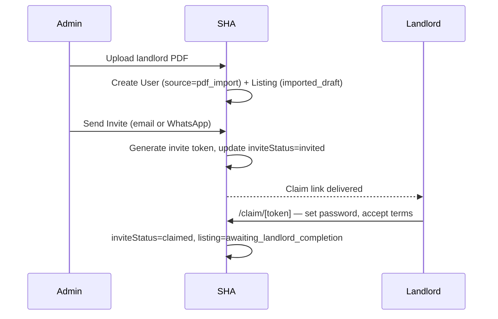
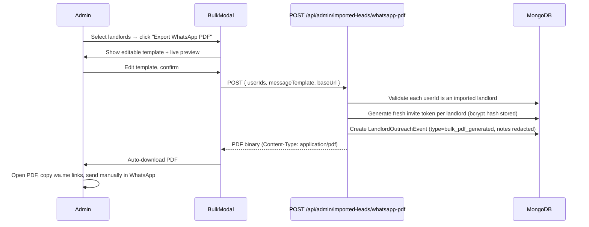

# Epic: Admin Bulk WhatsApp PDF Outreach for Imported Landlords

---

# SHA — Bulk WhatsApp PDF Outreach: Feature Specification

## Overview

This feature extends the existing SHA admin imported-landlord workflow to allow an admin to select multiple imported landlords, edit a shared WhatsApp message template, and generate one downloadable PDF containing a `wa.me` outreach link and a unique claim link for every selected landlord.

The import flow, claim flow, and admin dashboard are **not** changed. No WhatsApp messages are sent automatically.

## Existing Flow (unchanged)



## New Bulk WhatsApp PDF Flow



## Component Map

| File | Role |
| --- | --- |
| file:components/admin/BulkWhatsAppPdfModal.tsx | Modal UI — template editor, preview, validation, triggers API |
| file:app/api/admin/imported-leads/whatsapp-pdf/route.ts | Bulk PDF API — token generation, PDF build, event logging |
| file:lib/whatsapp.ts | Phone normalisation, `buildWhatsAppLink`, `appendClaimLink` |
| file:lib/admin/invite-helpers.ts | `resolveBaseUrl`, `buildLandlordClaimUrl` |
| file:lib/models/LandlordOutreachEvent.ts | Outreach event schema |
| file:tests/unit/whatsapp.test.mjs | Unit tests — phone, URL encoding, redaction |
| file:tests/unit/bulk-pdf.test.mjs | Unit tests — template rendering, eligibility, sanitisation |
| file:README.md | Documentation |

## Message Template

### Default template

```
Hello {landlordName}, this is Student Housing Archive.

We imported your rental listing details so students can find verified housing more easily.

Please claim your landlord account and complete your listing using this secure link:

{claimLink}

If you did not expect this message, you can ignore it.
```

### Supported placeholders

| Placeholder | Source | Required |
| --- | --- | --- |
| `{landlordName}` | `User.name` | No |
| `{claimLink}` | Generated claim URL | **Yes** |
| `{phone}` | `User.phone` (normalised) | No |
| `{expiresAt}` | `inviteTokenExpiresAt` ISO string | No |
| `{listingTitle}` | `Listing.title` | No |
| `{address}` | `Listing.area` / `Listing.landmark` | No |

### Validation rules

- If `{claimLink}` is absent from the final rendered message, the claim URL is automatically appended at the bottom (existing `appendClaimLink` behaviour).
- Duplicate claim links are prevented by `appendClaimLink` (already implemented).
- A character-count warning is shown when the rendered message exceeds 1 000 characters.

## Claim Link Generation

- Every selected landlord receives a fresh 32-byte hex token (`crypto.randomBytes(32).toString("hex")`).
- The raw token is bcrypt-hashed and stored in `User.inviteTokenHash`; the previous token is replaced.
- Token expiry: **14 days** from generation time.
- Claim links use the production base URL `https://studenthousingarchive.cfd` when the client passes `baseUrl` in the request body. The API falls back to `NEXTAUTH_URL` → `origin` header → `x-forwarded-host` in that order.
- The raw token is **never** stored in outreach event logs.

## Phone Normalisation

Handled by `buildWhatsAppLink` in file:lib/whatsapp.ts:

- Strip spaces, dashes, brackets, dots, `+`.
- Numbers starting with `0` → prefix with `263` (Zimbabwe default, overridable via `WHATSAPP_DEFAULT_COUNTRY_CODE`).
- Accept 7–15 digit strings only; reject everything else (returns `null`).
- Landlords with invalid/missing phones are **skipped** in the PDF with a warning count in the response headers.

## PDF Structure

The PDF is generated as a raw PDF 1.4 binary (no external library dependency) by `buildPdfBuffer` in the API route.

| Section | Content |
| --- | --- |
| Cover page | Title, batch ID, generated timestamp, selected count |
| Per-landlord page | Name, phone, normalised WhatsApp number, listing title, area, full message text, claim URL (clickable), `wa.me` URL, invite expiry |

The PDF is streamed directly as `application/pdf` with `Content-Disposition: attachment`. It is **not** stored server-side.

## Security

- Endpoint is admin-only (`session.user.role !== "admin"` → 403).
- Only `source: "pdf_import"` landlords are processed; arbitrary user IDs are rejected.
- Raw tokens are not stored in logs.
- Outreach event `notes` field stores a redacted message preview (claim URL replaced with `[CLAIM_LINK_REDACTED]`).
- `wa.me` URLs are not stored in logs.
- PDF is not cached (`Cache-Control: no-store`).

## Outreach Event Schema (existing, no changes needed)

```
LandlordOutreachEvent {
  landlordId, listingId, type, batchId, notes, createdBy, createdAt
}
```

`type` for bulk PDF: `"bulk_pdf_generated"` (already in enum).

## UI Wireframes

### BulkWhatsAppPdfModal — Template Editor State

```wireframe

<html>
<head>
<style>
* { box-sizing: border-box; margin: 0; padding: 0; font-family: system-ui, sans-serif; font-size: 14px; }
body { background: #f4f4f5; display: flex; align-items: center; justify-content: center; min-height: 100vh; padding: 16px; }
.modal { background: #fff; border: 1px solid #e4e4e7; border-radius: 12px; width: 100%; max-width: 640px; padding: 24px; box-shadow: 0 8px 32px rgba(0,0,0,0.12); }
.modal-title { font-size: 18px; font-weight: 600; }
.modal-desc { color: #71717a; margin-top: 4px; font-size: 13px; }
.section-label { font-size: 12px; font-weight: 600; text-transform: uppercase; letter-spacing: 0.08em; color: #71717a; margin-top: 20px; margin-bottom: 6px; }
textarea { width: 100%; border: 1px solid #d4d4d8; border-radius: 8px; padding: 10px 12px; font-size: 13px; line-height: 1.6; resize: vertical; min-height: 140px; background: #fafafa; }
.char-count { text-align: right; font-size: 11px; color: #71717a; margin-top: 4px; }
.char-warn { color: #d97706; }
.preview-box { border: 1px solid #e4e4e7; border-radius: 8px; background: #f9fafb; padding: 12px; font-size: 12px; line-height: 1.7; color: #374151; white-space: pre-wrap; max-height: 120px; overflow-y: auto; margin-top: 6px; }
.warn-banner { background: #fef3c7; border: 1px solid #fcd34d; border-radius: 8px; padding: 10px 12px; font-size: 12px; color: #92400e; margin-top: 12px; }
.landlord-list { border: 1px solid #e4e4e7; border-radius: 8px; background: #f9fafb; padding: 10px; max-height: 120px; overflow-y: auto; margin-top: 6px; }
.landlord-item { padding: 6px 8px; border-radius: 6px; background: #fff; border: 1px solid #e4e4e7; margin-bottom: 6px; }
.landlord-item:last-child { margin-bottom: 0; }
.landlord-name { font-weight: 500; }
.landlord-meta { font-size: 11px; color: #71717a; margin-top: 2px; }
.invalid-badge { display: inline-block; background: #fee2e2; color: #b91c1c; border-radius: 9999px; padding: 1px 8px; font-size: 10px; font-weight: 600; text-transform: uppercase; margin-left: 6px; }
.actions { display: flex; justify-content: flex-end; gap: 8px; margin-top: 20px; flex-wrap: wrap; }
.btn { padding: 8px 16px; border-radius: 8px; font-size: 13px; font-weight: 500; cursor: pointer; border: 1px solid #d4d4d8; background: #fff; }
.btn-primary { background: #18181b; color: #fff; border-color: #18181b; }
.btn:disabled { opacity: 0.5; cursor: not-allowed; }
.skip-note { font-size: 11px; color: #ef4444; margin-top: 8px; }
</style>
</head>
<body>
<div class="modal">
  <div class="modal-title">Export WhatsApp PDF</div>
  <div class="modal-desc">Editing shared message template for 4 selected landlords.</div>

  <div class="section-label">Message Template</div>
  <textarea data-element-id="template-editor">Hello {landlordName}, this is Student Housing Archive.

We imported your rental listing details so students can find verified housing more easily.

Please claim your landlord account and complete your listing using this secure link:

{claimLink}

If you did not expect this message, you can ignore it.</textarea>
  <div class="char-count">312 / 1000 characters</div>

  <div class="section-label">Live Preview (sample: Tariro Moyo)</div>
  <div class="preview-box">Hello Tariro Moyo, this is Student Housing Archive.

We imported your rental listing details so students can find verified housing more easily.

Please claim your landlord account and complete your listing using this secure link:

https://studenthousingarchive.cfd/claim/[token]

If you did not expect this message, you can ignore it.</div>

  <div class="section-label">Selected Landlords (4)</div>
  <div class="landlord-list">
    <div class="landlord-item">
      <div class="landlord-name">Tariro Moyo</div>
      <div class="landlord-meta">+263771234567 · Sakubva Flats</div>
    </div>
    <div class="landlord-item">
      <div class="landlord-name">John Banda<span class="invalid-badge">Invalid phone</span></div>
      <div class="landlord-meta">0123 · Dangamvura Rooms</div>
    </div>
    <div class="landlord-item">
      <div class="landlord-name">Grace Chikwanda</div>
      <div class="landlord-meta">+263772345678 · Chikanga House</div>
    </div>
    <div class="landlord-item">
      <div class="landlord-name">Peter Mutasa</div>
      <div class="landlord-meta">No phone · Hobhouse Cottage</div>
    </div>
  </div>
  <div class="skip-note">⚠ 2 landlords will be skipped (invalid or missing phone). PDF will include 2 valid entries.</div>

  <div class="actions">
    <button class="btn" data-element-id="cancel-btn">Cancel</button>
    <button class="btn btn-primary" data-element-id="generate-btn">Generate PDF (2 valid)</button>
  </div>
</div>
</body>
</html>
```

### BulkWhatsAppPdfModal — Generating State

```wireframe

<html>
<head>
<style>
* { box-sizing: border-box; margin: 0; padding: 0; font-family: system-ui, sans-serif; font-size: 14px; }
body { background: #f4f4f5; display: flex; align-items: center; justify-content: center; min-height: 100vh; padding: 16px; }
.modal { background: #fff; border: 1px solid #e4e4e7; border-radius: 12px; width: 100%; max-width: 640px; padding: 24px; box-shadow: 0 8px 32px rgba(0,0,0,0.12); }
.modal-title { font-size: 18px; font-weight: 600; }
.modal-desc { color: #71717a; margin-top: 4px; font-size: 13px; }
.spinner-row { display: flex; align-items: center; gap: 12px; margin-top: 32px; color: #71717a; font-size: 13px; }
.spinner { width: 24px; height: 24px; border: 3px solid #e4e4e7; border-top-color: #18181b; border-radius: 50%; animation: spin 0.8s linear infinite; }
@keyframes spin { to { transform: rotate(360deg); } }
.actions { display: flex; justify-content: flex-end; gap: 8px; margin-top: 32px; }
.btn { padding: 8px 16px; border-radius: 8px; font-size: 13px; font-weight: 500; cursor: pointer; border: 1px solid #d4d4d8; background: #fff; opacity: 0.5; }
.btn-primary { background: #18181b; color: #fff; border-color: #18181b; }
</style>
</head>
<body>
<div class="modal">
  <div class="modal-title">Export WhatsApp PDF</div>
  <div class="modal-desc">Generating PDF for 2 landlords…</div>
  <div class="spinner-row">
    <div class="spinner"></div>
    Generating secure claim links and building PDF…
  </div>
  <div class="actions">
    <button class="btn" disabled>Cancel</button>
    <button class="btn btn-primary" disabled>Generating…</button>
  </div>
</div>
</body>
</html>
```

## API Contract

### `POST /api/admin/imported-leads/whatsapp-pdf`

**Request body**

```json
{
  "userIds": ["<mongoId>", "..."],
  "messageTemplate": "Hello {landlordName}...",
  "baseUrl": "https://studenthousingarchive.cfd"
}
```

**Success response** — `200 application/pdf` with headers:

| Header | Value |
| --- | --- |
| `Content-Disposition` | `attachment; filename="sha-whatsapp-pdf-<batchId>.pdf"` |
| `Cache-Control` | `no-store` |
| `X-Batch-Id` | UUID |
| `X-Export-Count` | Number of PDF rows generated |

**Error responses**

| Status | Condition |
| --- | --- |
| 401 | No session |
| 403 | Non-admin session |
| 400 | Empty or invalid `userIds` |
| 404 | No matching imported landlords |
| 409 | All matched landlords are ineligible (already claimed / wrong listing status) |
| 500 | Base URL unresolvable or PDF build failure |

## Test Coverage

| Test file | Scenarios covered |
| --- | --- |
| file:tests/unit/whatsapp.test.mjs | Zimbabwe prefix, international numbers, stripping, too-short rejection, null/empty, URL encoding, `appendClaimLink` deduplication, `resolveBaseUrl` fallback chain, global redaction |
| file:tests/unit/bulk-pdf.test.mjs | `normalizeUserIds`, `buildClaimUrl` trailing slash, `buildMessage` interpolation + deduplication, `sanitizePdfText` character stripping, `isEligibleUser` contract |

Both test files are already complete. A `test:unit` npm script needs to be added to file:package.json.

## Documentation

file:README.md already contains a **WhatsApp Outreach** section covering the single-landlord flow. A **Bulk WhatsApp PDF** subsection must be added covering:

- How to select landlords and open the modal.
- Editing the shared message template.
- How the PDF is generated and downloaded.
- That `wa.me` links open WhatsApp but do **not** auto-send messages.
- That production claim links use `https://studenthousingarchive.cfd/claim/{token}`.
- Phone number requirements and the Zimbabwe default country code.
- Security note: generated PDFs contain sensitive claim links and should be handled securely.